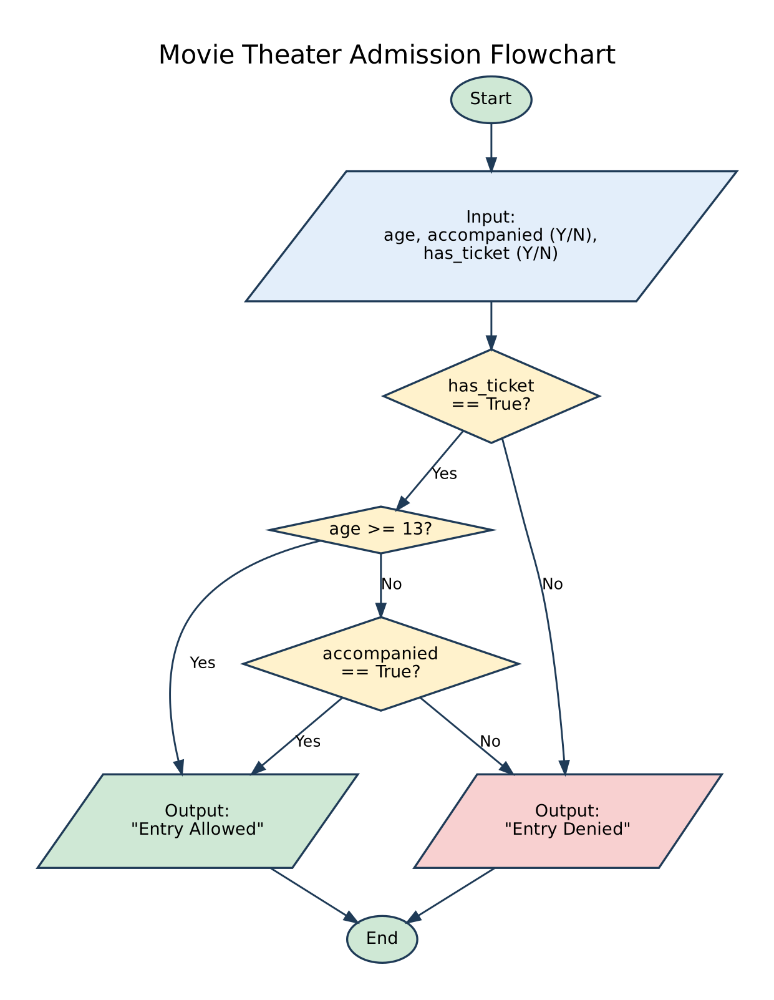

# Tutorial 1 – Movie Theater Admission

**Name:** Nasir Mohamed Abdelgafar Elyas
**Student ID:** 202405010110

## Scenario

A movie theater lets a person in if:

- they are **13 years old or older**, **OR**
- they are **accompanied by an adult**, **AND**
- they **have a valid ticket**.

As one logical expression:

```
Entry = (age >= 13 OR accompanied) AND has_ticket
```

The ticket is required in every case. Age and adult company are alternatives: having either one is enough.

---

## 1. Identify the Components

### 1.1 Inputs

| Input | Type | Description |
|---|---|---|
| `age` | Integer | The person's age in years |
| `accompanied` | Boolean (True/False) | Is the person with an adult? |
| `has_ticket` | Boolean (True/False) | Does the person have a valid ticket? |

### 1.2 Process

1. Check the age condition: `A = age >= 13`
2. Combine it with the adult condition: `A OR accompanied`
3. Combine that result with the ticket condition: `(A OR accompanied) AND has_ticket`
4. If the final result is True, the person may enter. Otherwise they may not.

### 1.3 Output

A message: **"Entry Allowed"** or **"Entry Denied"**.

---

## 2. Design the Algorithm

### 2.1 Flowchart



> Made with Graphviz. The source is in [`flowchart.dot`](flowchart.dot).

### 2.2 Truth Table

Let:

- **A** = age ≥ 13
- **B** = accompanied by an adult
- **C** = has a valid ticket

| A (age ≥ 13) | B (with adult) | C (ticket) | A OR B | (A OR B) AND C | Result |
|:---:|:---:|:---:|:---:|:---:|:---|
| T | T | T | T | **T** | Entry Allowed |
| T | T | F | T | F | Entry Denied |
| T | F | T | T | **T** | Entry Allowed |
| T | F | F | T | F | Entry Denied |
| F | T | T | T | **T** | Entry Allowed |
| F | T | F | T | F | Entry Denied |
| F | F | T | F | F | Entry Denied |
| F | F | F | F | F | Entry Denied |

Only 3 of the 8 cases allow entry, and all 3 have a ticket.

### 2.3 Algorithm (Step-by-Step Solution)

1. Start.
2. Ask for the person's age and store it in `age`.
3. Ask whether the person is with an adult and store it in `accompanied`.
4. Ask whether the person has a valid ticket and store it in `has_ticket`.
5. If `has_ticket` is False, display "Entry Denied" and go to step 8.
6. If `age >= 13` **or** `accompanied` is True, display "Entry Allowed".
7. Otherwise, display "Entry Denied".
8. End.

### 2.4 Pseudocode

```
BEGIN
    INPUT age
    INPUT accompanied        // True / False
    INPUT has_ticket         // True / False

    IF (age >= 13 OR accompanied = True) AND has_ticket = True THEN
        OUTPUT "Entry Allowed"
    ELSE
        OUTPUT "Entry Denied"
    ENDIF
END
```

---

## 3. Evaluate Expression

### 3.1 Test with Input Samples

| # | age | accompanied | has_ticket | (age ≥ 13 OR accompanied) | AND has_ticket | Output |
|:---:|:---:|:---:|:---:|:---:|:---:|:---|
| 1 | 15 | False | True | True | True | Entry Allowed |
| 2 | 10 | True | True | True | True | Entry Allowed |
| 3 | 10 | False | True | False | False | Entry Denied |
| 4 | 20 | True | False | True | False | Entry Denied |
| 5 | 13 | False | True | True | True | Entry Allowed *(boundary: exactly 13)* |
| 6 | 12 | False | True | False | False | Entry Denied *(boundary: just under 13)* |

**Worked example (Sample 3):** age = 10, accompanied = False, has_ticket = True

```
(10 >= 13 OR False) AND True
= (False OR False) AND True
= False AND True
= False   ->  Entry Denied
```

The child has a ticket, but they are under 13 and alone, so the first part fails.

**Worked example (Sample 4):** age = 20, accompanied = True, has_ticket = False

```
(20 >= 13 OR True) AND False
= (True OR True) AND False
= True AND False
= False   ->  Entry Denied
```

Being an adult doesn't help without a ticket, because `AND` needs both sides to be True.

### Python Implementation

The whole activity is coded in [`admission.py`](admission.py). When you run it, it:

1. Prints the inputs, process and output.
2. Generates the truth table from the `can_enter()` function, so it isn't typed out by hand.
3. Runs the six test samples above and checks each one against the expected answer.
4. Asks for your own age, adult and ticket inputs and prints the decision.

The core logic is one line:

```python
def can_enter(age, accompanied, has_ticket):
    old_enough = age >= 13
    return (old_enough or accompanied) and has_ticket
```

Run it with:

```bash
python admission.py
```

Test sample output:

```
 Age | Adult | Ticket | Result        | Check
--------------------------------------------------
  15 | False | True   | Entry Allowed | PASS
  10 | True  | True   | Entry Allowed | PASS
  10 | False | True   | Entry Denied  | PASS
  20 | True  | False  | Entry Denied  | PASS
  13 | False | True   | Entry Allowed | PASS
  12 | False | True   | Entry Denied  | PASS

6/6 tests passed
```

---

## 4. Update Files Using Git & Push

```bash
git status
git add tutorial_1/w2_tutorial.md
git add tutorial_1/flowchart.png tutorial_1/flowchart.dot
git add tutorial_1/admission.py
git commit -m "Add Tutorial 1: movie theater admission"
git push
```
