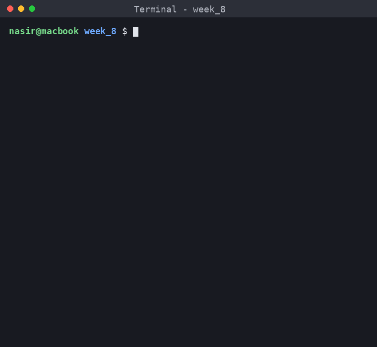

# Food Delivery Receipt Generator

**Week 8 – Tutorial 8**
**Name:** Nasir Mohamed Abdelgafar Elyas
**Student ID:** 202405010110



---

## 1. Purpose of the Application

This is the **backend receipt generator** for a Food Delivery System. The UI team hasn't finished the graphical interface yet, so this program runs in the terminal.

It:

1. Collects the customer's order: name, food (Cake or Muffin), quantity, price per item, and whether they want delivery.
2. Calculates the bill:
   - **Subtotal** = quantity × price
   - **Service charge** = 5% of the subtotal, rounded to the nearest sen so the receipt always adds up
   - **Delivery charge** = RM 5.00 if delivery is chosen, otherwise RM 0.00
   - **Total** = subtotal + service charge + delivery charge
3. Prints a formatted receipt.

Following industry practice, each responsibility lives in its own module instead of everything being in one file:

| Module | Responsibility |
|---|---|
| `customer.py` | **Input:** collects and validates the customer's details, and decides the delivery charge (if-else) |
| `receipt.py` | **Processing + output:** calculates the subtotal, service charge and total, and prints the receipt |
| `main.py` | **Application:** imports the two modules and connects them: get the customer data, then print the receipt |

```
main.py
  ├── customer.get_customer()  ->  name, food, quantity, price, delivery_charges
  └── receipt.print_receipt(name, food, quantity, price, delivery_charges)
```

Because the modules are separate, the UI team can later replace `customer.py` with a graphical form and still reuse `receipt.py` unchanged.

---

## 2. Tech Stack

| Tool | Use |
|---|---|
| **Python 3** | Programming language (no external libraries needed) |
| **Python modules** | `customer.py`, `receipt.py` and `main.py`, connected with `import` |
| **Terminal / command line** | Running the program and entering input |
| **Git & GitHub** | Version control and submission |

---

## 3. How to Use

### Run the program

From inside the `week_8` folder:

```bash
python main.py
```

(On some machines, use `python3 main.py`.)

### Enter the order

The program asks for each value in turn:

| Prompt | What to enter | Rules |
|---|---|---|
| Customer Name | Any name | Can't be empty |
| Food Ordered (Cake/Muffin) | `Cake` or `Muffin` | Not case-sensitive. Anything else is asked again |
| Quantity | A whole number | Must be more than 0 |
| Price per Item (RM) | A number, e.g. `3.00` | Must be more than 0 (`inf` and `nan` are rejected) |
| Delivery (Y/N) | `Y` or `N` | `Y` adds RM 5.00 delivery |

If an entry is invalid, the program explains why and asks again instead of crashing.

### Example

```
=== Customer Information ===
Customer Name : izzad
Food Ordered (Cake/Muffin) : Cake
Quantity : 2
Price per Item (RM): 3.00
Delivery (Y/N): Y

========== RECEIPT ==========
Customer : izzad
Food     : Cake
Quantity : 2
Price    : RM 3.00
-----------------------------
Subtotal : RM 6.00
Service Charge (5%) : RM 0.30
Delivery Charge : RM 5.00
-----------------------------
TOTAL    : RM 11.30
=============================
```

**Checking the maths:** 2 × RM 3.00 = **RM 6.00**. 5% of 6.00 = **RM 0.30**. Delivery = **RM 5.00**. Total = 6.00 + 0.30 + 5.00 = **RM 11.30**.

---

## 4. Demonstration

The GIF at the top of this page ([`demo/demo.gif`](demo/demo.gif)) shows a full run of the program with the sample input above, from typing `python main.py` to the printed receipt.
